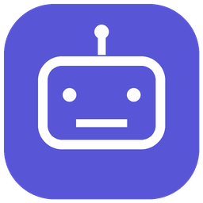
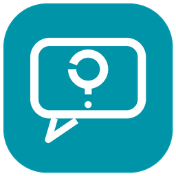
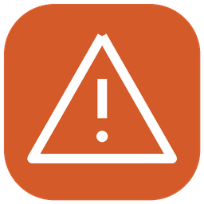
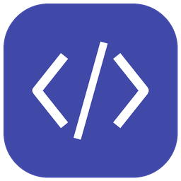

# Agent Bark — уведомления от AI-агентов

Небольшой MCP-сервер отправляет важные запросы агента в установленный на iPhone [Bark](https://github.com/Finb/Bark). Есть группировка по проекту, готовые иконки, ограничения повторов и локальное хранение ключа. Ответы и согласования остаются в исходном чате; инструмент не принимает решений за владельца.

**Состояние:** ранний пилот. Личная версия проекта проверена на macOS с реальным уведомлением и аватаром на iPhone. Переносимая версия прошла тесты и пробный вызов MCP без отправки на Linux; реальная доставка с Linux и совместимость с конкретными агентами ещё не проверены.

## Когда уведомлять

| Тип | Смысл |
| --- | --- |
| `question` | Агент не может продолжить без ответа человека. |
| `approval` | Подготовлено конкретное действие, нужно разрешение. |
| `review` | Существенная работа полностью готова к проверке. |
| `error` | Серьёзная проблема требует владельца. |

Не отправляйте промежуточный прогресс и не используйте критические оповещения для обычной работы. После обработки всех независимых задач сообщение должно содержать один краткий вопрос или результат.

## Быстрый запуск: macOS / Linux

Нужны Python 3.10+, `git`, приложение Bark на iPhone и доступ в интернет. Включите уведомления Bark и проверьте встроенный тест приложения.

```bash
git clone https://github.com/omiusgm/agent-bark-setup.git
cd agent-bark-setup
python3 -m venv .venv
.venv/bin/python -m pip install -r requirements.txt
.venv/bin/python setup_browser.py
```

На компьютере откроется временная страница `127.0.0.1`. Вставьте в неё ключ или пример ссылки из Bark — **не отправляйте их в чат**. На macOS ключ хранится в Связке ключей под именем `agent-bark-setup`; на Linux — в `~/.config/agent-bark-setup/device-key` с правами `0600`. Уже существующий ключ не перезаписывается. Для Linux без браузера настройка пока требует ручной подготовки приватного файла; не передавайте его через публичные сервисы.

Проверка: `.venv/bin/python test_push.py`. `accepted_by_bark` означает принятие сервером, а не показ на iPhone. Если сообщение не появилось, проверьте разрешения iOS, интернет и настройки Bark. Одинаковый тест не отправится повторно в течение часа.

Для Codex с CLI из папки проекта:

```bash
codex mcp add agent-bark -- "$PWD/.venv/bin/python" "$PWD/mcp_server.py"
```

После добавления откройте новый сеанс Codex и убедитесь, что инструмент `send_attention` действительно доступен. У других MCP-клиентов используйте те же абсолютные пути к Python и `mcp_server.py` в настройках stdio MCP. Автоматической регистрации для Dot, Claude Code или удалённого Linux здесь нет. Среды могут требовать собственных разрешений на вызовы.

## Правило для агента

Добавьте в инструкции своему агенту:

> Используй MCP `agent-bark` и `send_attention` только когда мне нужен ответ для продолжения, согласование подготовленного действия, проверка всей завершённой работы или помощь при серьёзном сбое. Перед обращением сделай всё, что можешь без меня. Передавай `kind`, краткие `project`, `chat`, `host`, `message` и стабильный `event_id` события. Не включай секреты и личные данные. Не отправляй обычный прогресс. Уведомление не является моим согласием.

У инструмента есть необязательные `icon`, `url` и `dry_run`. `dry_run=true` создаёт только пример и не обращается к сети или ключу. Параметр `url` пока принимает только `https://t.me/...` и `https://telegram.me/...`; переход по ссылке зависит от приложения на iPhone. Ссылка для конкретного чата Codex Remote не подтверждена.

## Готовые иконки

Аватары для разных ролей (созданы с помощью ImageGen, вдохновлены образом агента Ёж):

| Ёж | Координатор | Разработчик | Инфраструктура |
| --- | --- | --- | --- |
|  |  |  |  |
| `hedgehog` | `coordinator` | `developer` | `infrastructure` |

Также доступны простые пиктограммы:

| Агент | Согласование | Вопрос | Готово |
| --- | --- | --- | --- |
|  |  |  |  |
| `agent` | `approval` | `question` | `complete` |

| Ошибка | Код | Проект | Сервер |
| --- | --- | --- | --- |
|  |  |  |  |
| `warning` | `code` | `project` | `server` |

Укажите имя из таблицы в поле `icon`. Прямые адреса: `https://raw.githubusercontent.com/omiusgm/agent-bark-setup/main/icons/hedgehog-v2.jpg` и аналогичные для других аватаров; пиктограммы используют имена вида `agent.png`. Файлы JPEG и PNG, 256×256; iPhone должен иметь возможность загрузить адрес. Наличие HTTP-ответа не гарантирует показ картинки на каждом устройстве. Оригиналы можно менять и распространять по лицензии MIT.

## Приватность и ограничения

- Пилот отправляет данные через публичный `api.day.app` и Apple APNs. Не включайте в уведомления пароли, ключи, личные письма и клиентские данные. Это не зашифрованный режим Bark.
- Ключ — доступ к отправке на ваше устройство. Не публикуйте его, не помещайте в команды, логи, файлы репозитория или промпты. Не копируйте ключ между компьютерами без согласия владельца.
- Защита от повторов работает на одном компьютере: одинаковые `kind`, `host`, `event_id` подавляются на час. Разные компьютеры не координируют дубли. При неопределённом ответе (`uncertain`) сначала проверьте телефон, не отправляйте повторно вслепую.
- Сервер сам не наблюдает за всеми чатами: агент должен вызвать инструмент. В некоторых сценариях системный запрос прав может не попадать агенту. Ссылки и доставка могут зависеть от версии ОС, сети и настроек.
- Ссылка на картинку загружается из GitHub; владелец хоста изображения может видеть запрос. Для чувствительных проектов выбирайте нейтральную иконку.

## Проверки разработки

`python3 -m unittest discover -s tests -v`. При необходимости PNG регенерируются скриптом `icons/generate.py` с Pillow; для работы MCP Pillow не требуется.

Проект не является официальным продуктом разработчиков Bark или OpenAI.
